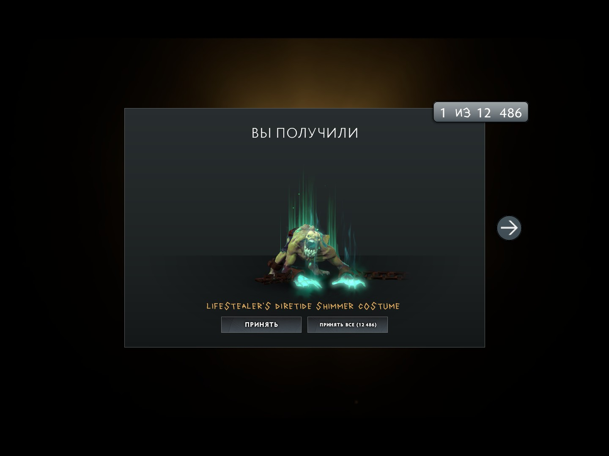
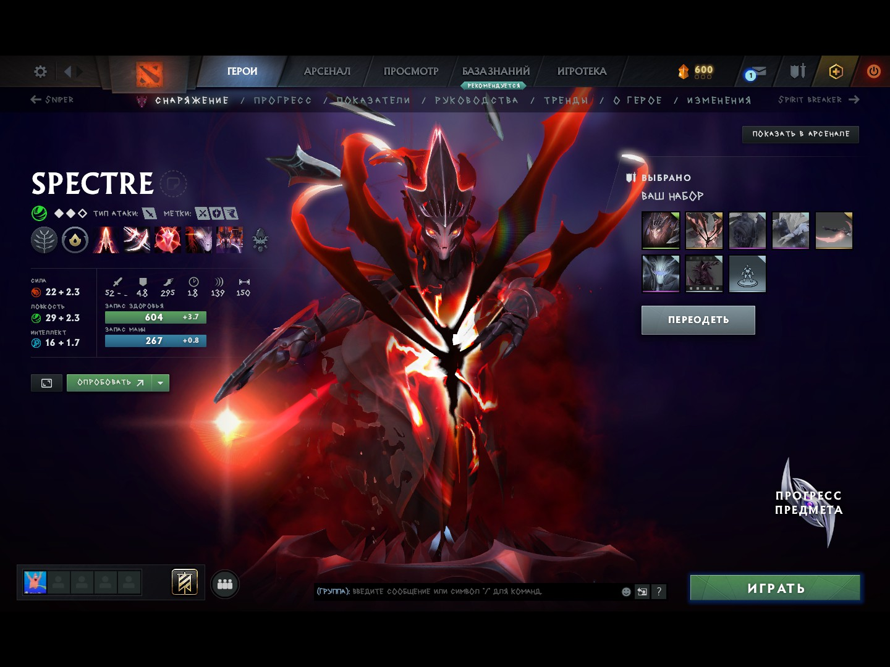

# anchousechanger

Open-source internal Dota 2 skin changer for Windows.




## Features

- Any item added to the inventory and equipped from the hero loadout
- Styles unlocked, sockets, prismatic and ethereal gems
- Per-item unusual effect picker
- Items, arcana models and effects applied in matches

## Building

Requirements:

- Visual Studio 2022 or newer with the **Desktop development with C++** workload
- CMake
- Internet access on the first build

Run `build.bat`. It downloads and builds protobuf, fetches the Dota 2 protobuf
schemas, generates the message sources, and produces:

- `build/anchousechanger.dll`
- `build/loader.exe`

The first build takes several minutes because protobuf is compiled from source.
Later builds reuse `.deps/` and are much faster.

Useful commands:

```bat
build.bat            :: build DLL and loader
build.bat rebuild    :: regenerate protobufs and rebuild
build.bat clean      :: remove build output only
build.bat distclean  :: remove build, generated protos and .deps
build.bat nopause    :: build without the final pause
```

The Dota 2 protobuf revision is pinned in `build.bat` (`PROTO_SHA`). If a game
update changes the GC schema, update that hash and run `build.bat rebuild`.

## Usage

1. Start Dota 2 and wait for the main menu.
2. Run `build\loader.exe`. Use `build\loader.exe --launch` to start the game
   through Steam first. The loader injects `anchousechanger.dll` from its own
   directory by default.

Loader options:

```text
loader.exe [options] [dll_path]

--launch, -l      Start Dota 2 through Steam if it is not running
--pid <pid>, -p   Inject into a specific process
--dll <path>, -d  Use a custom DLL path
--help, -h        Show help
```

Every equippable cosmetic is added to the inventory automatically, so all skins
are available in the hero loadout without pressing anything. The `+` button
remains for bundles and entries outside the wearable catalog:



The first injection writes the full catalog to `anchousechanger.cfg` beside the DLL,
so the file can grow to a few MB. Delete it to reset the fake inventory and
settings.

After injection the mod asks the game client to re-subscribe its item cache the
same way it does when connecting to the GC, and merges the whole catalog into
that single cache snapshot. The inventory is rebuilt once, with every skin
already inside, so the items look like they were always there and no per-item
stream is sent to the UI.

Sizing note: the Dota 2 client spends CPU proportional to the current inventory
size on every item it applies from live GC updates (about 0.7 microseconds per
already-owned item), so feeding ~11.7k items in batches costs the client around
a minute of work no matter how the mod paces them. Delivering them inside one
cache snapshot is the only path that can rebuild the inventory in one pass. If
the client does not re-subscribe within a few seconds, the mod falls back to a
safe paced delivery: one small GC message per frame, sized so the window never
stops responding.

The behavior is configurable in `anchousechanger.cfg` (add the keys on separate
lines):

```ini
skin.grant.snapshot=0  ; never merge the catalog into cache snapshots
skin.grant.probe=0     ; do not ask the client to re-subscribe, only stream
skin.grant.wait=9      ; seconds to wait for a snapshot before streaming
skin.grant.chunk=256   ; items per streamed message (0 = one message, freezes)
skin.autogrant=0       ; disable automatic catalog injection entirely
```

## Diagnostics

`build\anchousechanger.log` gets a `[milliseconds]` prefix on every line, so a hang
can be located by the last lines written. A background watchdog prints a line
every 15 seconds:

```text
[  90000] [+] Watchdog: frames=5231 queued=0 delivery=11677/11677 mode=2
```

`mode` is `0` while waiting for a cache snapshot, `1` while streaming and `2`
when the catalog was merged into a snapshot.

Grant stages appear as:

```text
[  1500] [+] Grant: refresh -> gc (EMsg 28, attempt 1/5)  <- ask the GC for the cache
[  1620] [+] SO cache subscribed owner ...                <- the GC sent the snapshot
[  1640] [+] Subscribe: 1 real items, 0 replaced, 11764 fakes added, 403 -> 460434 bytes
[  1695] [+] Pump: 74 ms                                  <- one-time cache rebuild
```

When the GC ignores the refresh, the mod keeps probing (a cache check message
to the client at 4 s, a Dota cache-resend message at 6.5 s) and retries the
refresh every 4 seconds. If no snapshot arrives within `skin.grant.wait`
seconds, streaming starts and the log switches to `Grant: streamed` lines:

```text
[  9000] [+] Grant: no snapshot after 9000 ms, streaming 11764 items by 256
[  9010] [+] Grant: streamed 256/11764 (256 items, 9010 ms)
```

If the game freezes:

- the watchdog lines keep appearing with `frames=` stuck - the main thread is
  busy inside the game (usually while applying items); note the last `Grant:`
  and `Pump:` lines and the `mode=`,
- the whole log stops - the process is fully locked, note the very last line,
- `queued=1` with `frames=` stuck means the client did not consume an injected
  GC message; set `skin.autogrant=0` to confirm the source,
- to rule out the cache-snapshot path, set `skin.grant.snapshot=0` and
  `skin.grant.probe=0`; the mod then only streams batches and never resizes
  snapshots.

## License

GPL-3.0
